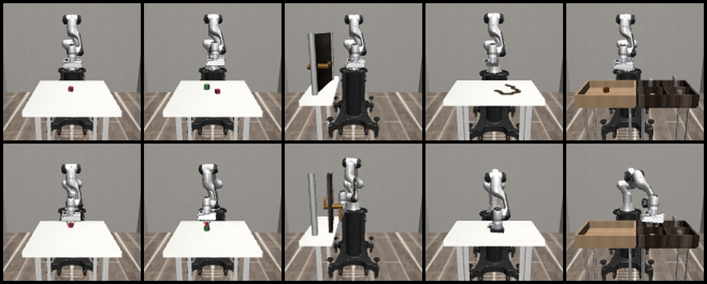
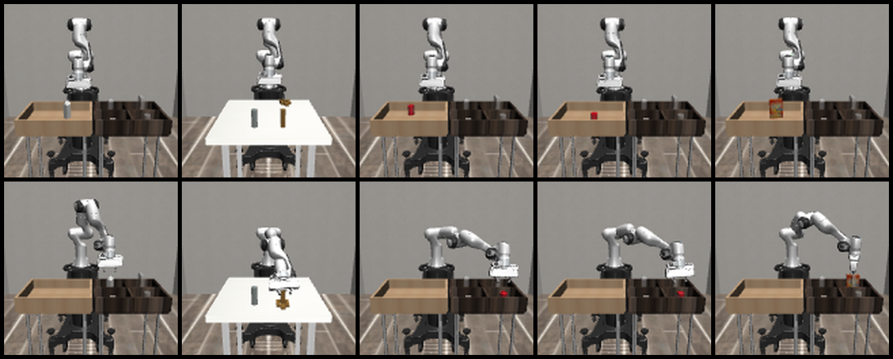
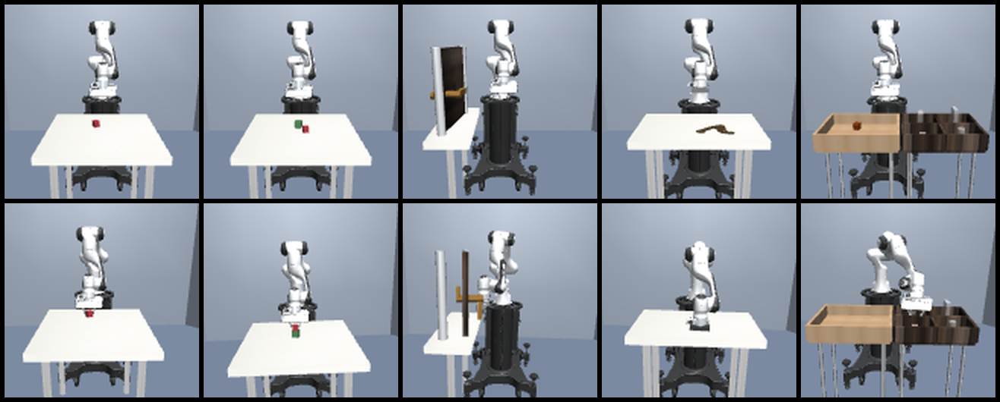
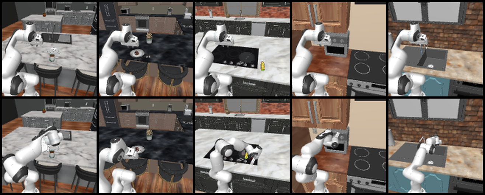

# WAM-0.1

**WAM-0.1 (World Action Model)** is an image-and-action robotics dataset for learning Panda robot dynamics and visual world representations with H-JEPA-style models.

Maintained by **Atom Ctrl** and **Aditya Panigrahi**.

- Website: [atomctrl.com](https://atomctrl.com)
- Dataset: [atomctrl/wam-0.1 on Hugging Face](https://huggingface.co/datasets/atomctrl/wam-0.1)

## What the dataset contains

WAM-0.1 combines successful Panda demonstrations from two simulated robotics sources:

- **RoboSuite**: official Panda manipulation tasks with normal and controlled randomized trajectories.
- **RoboCasa**: official kitchen and household manipulation demonstrations collected using the same WAM representation.

The dataset stores synchronized RGB observations, depth observations, robot state, actions, task metadata, and trajectory identifiers.

## Two learning levels

### Level 0: one-step dynamics

    input image + one 7D action -> next observation image

The action is represented as:

    [dx, dy, dz, dRx, dRy, dRz, gripper]

Each transition contains an input observation, the Panda action, the resulting observation, robot state, and metadata.

### Level 1: action chunks and subgoals

    starting image + action chunk -> future subgoal image

Level 1 endpoints come from the same underlying Level 0 trajectory:

    Level 0: image[t] + action[t] -> image[t + 1]
    Level 1: image[start] + actions[start:start+8] -> image[start + 8]

Level 1 samples are not randomly paired. They are built from contiguous Level 0 transitions.

## Visual examples

### RoboSuite normal trajectories

### RoboSuite randomized trajectories

### RoboCasa demonstrations

## Core RoboSuite tasks

- Lift
- Stack
- Door
- Wipe
- PickPlaceBread
- PickPlaceMilk
- PickPlaceCereal
- PickPlaceCan
- PickPlaceSingle
- NutAssemblySquare

RoboCasa contributes additional official household and kitchen manipulation tasks.

## Cameras and observations

The dataset uses synchronized camera views including agentview, frontview, and sideview.

The standard image resolution is **128 x 128 pixels**. Input and output comparisons must use the same camera stream and the same trajectory.

## GitHub repository layout

The GitHub repository contains code, schemas, documentation, validation tools, and visual examples. Large raw data files are hosted separately on Hugging Face.

    wam-0.1/
    ├── .gitignore
    ├── LICENSE
    ├── README.md
    ├── pyproject.toml
    ├── configs/
    │   ├── controller_test.json
    │   ├── hjepa_schema_v1.json
    │   ├── project.json
    │   └── tasks.json
    ├── docs/
    │   ├── DATA_FORMAT.md
    │   └── WORKFLOW.md
    ├── media/
    │   ├── wam-0.1-normal-top.png
    │   ├── wam-0.1-normal-bottom.png
    │   ├── wam-0.1-random-top.png
    │   └── wam-0.1-robocasa-bottom.png
    └── scripts/
        ├── collect_batch.py
        ├── collect_robocasa.py
        ├── replay_official_robocasa.py
        ├── test_controller.py
        ├── test_two_levels.py
        ├── validate_final_tasks.py
        └── ...

Raw dataset files, shards, videos, logs, temporary test outputs, and local environments are excluded from the GitHub code repository.

## Dataset layout

    data/
    └── final/
        ├── level_0/
        │   ├── normal/
        │   │   ├── <robosuite-task>/
        │   │   └── robocasa/
        │   └── random/
        │       └── <robosuite-task>/
        └── level_1/
            ├── normal/
            │   ├── <robosuite-task>/
            │   │   └── trajectory_*/
            │   └── robocasa/
            └── random/
                └── <robosuite-task>/

Each Level 1 sample is derived from a corresponding contiguous Level 0 sequence.

## Download the dataset

    pip install -U huggingface_hub

    hf download atomctrl/wam-0.1 \
      --repo-type dataset \
      --local-dir wam-0.1-data

The raw data is distributed in shards. You can download only the shard required for a particular task.

## Run the project tools

    source ~/robotics/roboenv/bin/activate
    cd ~/robotics/wam-0.1

    python scripts/show_plan.py
    python scripts/test_controller.py
    python scripts/test_two_levels.py
    python scripts/validate_final_tasks.py

See [docs/DATA_FORMAT.md](docs/DATA_FORMAT.md) for the storage contract and [docs/WORKFLOW.md](docs/WORKFLOW.md) for the collection and validation workflow.

## Intended use

WAM-0.1 is intended for action-conditioned world models, H-JEPA representation learning, one-step dynamics prediction, long-horizon subgoal prediction, visual planning and control, Panda manipulation research, and simulation-to-real robotics research.

## License

The project code is released under the **GNU Affero General Public License v3.0**. See [LICENSE](LICENSE).

The dataset and upstream RoboSuite and RoboCasa components may have additional terms. Review their licenses before redistribution or commercial use.

## Citation

    @dataset{panigrahi_wam_0_1,
      author    = {Aditya Panigrahi},
      title     = {WAM-0.1: World Action Model Dataset},
      year      = {2026},
      publisher = {Atom Ctrl},
      url       = {https://huggingface.co/datasets/atomctrl/wam-0.1}
    }
